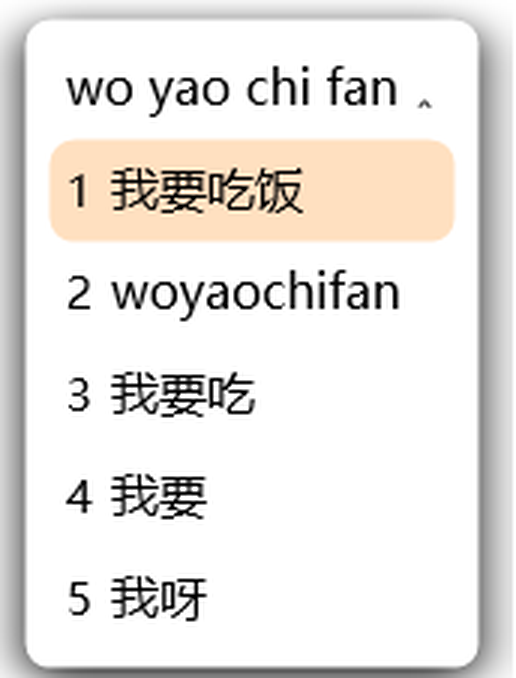

# 皮皮输入法 · Pipi IME

> 一个不用切中英模式的拼音输入法。打的像拼音就是中文，像英文就是英文，空格永远上屏正确的那个。

基于 [Rime / Weasel 小狼毫](https://github.com/rime/weasel)（GPL-3.0）的配置层实现。不修改引擎，全部逻辑用 Lua 插件 + 配置完成。



---

## 它想解决什么问题

传统输入法有一个二十多年没变的设计：**你必须先告诉它你要打中文还是英文**，按 Shift 切换。

于是就有了这个经典场景——你以为在中文模式，噼里啪啦打完一串，抬头发现全是字母，只能删掉重打。

皮皮的做法是：**不判断模式，判断你打出来的东西。**

| 你打的 | 它认为 | 按空格的结果 |
|---|---|---|
| `woyaochifan` | 拼音 | 我要吃饭 |
| `meeting` | 英文 | meeting |
| `nihao` | 拼音 | 你好 |
| `hello` | 英文 | hello |

判断规则：能否完整切成合法拼音音节 + 是否命中高频英文词表。两个都满足时优先英文（因为英文单词恰好也是合法拼音的概率很低）。

第二个设计是**候选第 2 位永远是「原样字母」**：

```
wo yao chi fan
1. 我要吃饭        ← 空格上屏
2. woyaochifan    ← 想让字母原样出去时按 2
3. 我要吃
4. 我要
5. 我呀
```

输网址、敲代码、写变量名的时候不用切模式，按个 2 就行。

---

## 安装

**前提**：Windows 10 / 11。需要先有小狼毫引擎。

### 第一步：装小狼毫

去 [rime/weasel releases](https://github.com/rime/weasel/releases) 下载最新安装包，装好。

> 为什么不能打包在一起：小狼毫是 GPL-3.0，再分发二进制要连带提供源码。让你自己从官方下载，干净一些。

### 第二步：装皮皮

**方式 A：一行命令**（推荐，约 30 秒）

右键「开始」→ **终端(管理员)**，粘贴：

```powershell
irm https://raw.githubusercontent.com/NengShuo/pipi-ime/main/install-online.ps1 | iex
```

会自动下载配置、改角标、编译方案、重启服务。全程不用管。

> 连不上 GitHub 也不用担心，脚本内置了 jsdelivr 和 ghproxy 两个备用源。

**方式 B：下载压缩包**

1. 下载 [pipi-ime-v0.1.zip](https://github.com/NengShuo/pipi-ime/releases/download/v0.1/pipi-ime-v0.1.zip)，解压
2. 双击 `install.bat`，UAC 点「是」
3. 等它跑完（第一次编译约 10–30 秒，任务栏会闪一下）

两种方式效果一样。装完新开一个窗口就能打字了。

---

## 用法

- **打字直接打**，不用管中英模式
- **空格** 上屏第 1 位（自动识别出来的那个）
- **数字键 1–5** 选其他候选
- **第 2 位** 是这个字母串本身，原始上屏
- **Ctrl + 空格** 切换中英文输入法（保留给习惯的人，其实用不上）

候选窗是竖排单列，圆角 + 投影，暖橙高亮。

---

## 关于右下角的角标

先说一个容易误解的地方：**托盘上那格「输入法位置」是 Windows 画的，不是皮皮画的。**

最多可能出现三个格子，来源完全不同：

| 格子 | 是谁画的 | 图标从哪来 | 什么时候出现 |
|---|---|---|---|
| 小狼毫托盘图标 | WeaselServer | `schema/icon` | 进程在就一直有 |
| 输入法模式按钮（22px） | Windows，内容由输入法提供 | 同一个 `schema/icon` | 当前输入法是皮皮时 |
| 输入法指示器（36px） | Windows | HKLM 里那条 TIP 记录的 `IconFile` | **装了 2 个以上输入法时** |

用窗口枚举（`GetClassName` + `FindWindowEx`）能看到它们的真实容器：模式按钮叫 `IMEModeButton`、指示器叫 `InputIndicatorButton`，都在 `TrayInputIndicatorWClass` 里。

所以装完之后右下角长什么样，**取决于你机器上有几个输入法**：

| 你的情况 | 右下角 |
|---|---|
| 皮皮 + 微软拼音（多数人的默认） | `蓝牙 [空] P 时钟` |
| 只有皮皮 | `蓝牙 时钟`，打字时那格才亮一个 P |

`P` 是你点开输入法时显示的那个（图标已由安装脚本换成皮皮的）。中间那格空档是 Windows 给「输入法模式」固定预留的。

---

### 想要「只有一个皮皮 P，没有空档」

两步：

1. **删掉微软拼音** —— 设置 → 时间和语言 → 语言 → 中文(简体) → 选项 → 删除「微软拼音」
   （想加回来：同一页点「添加键盘」。删之前先确认皮皮能正常打字）
2. **把图标换成可见的 P** —— 打开 `%APPDATA%\Rime\luna_pinyin_simp.custom.yaml`，把两处 `pipi-blank.ico` 改成 `pipi-p.ico`，然后双击 `皮皮维护.bat` 重新部署

做完就是 `蓝牙 [P] 时钟`：打字时那格显示 P，不打字时是空的——跟系统自带的输入法指示器行为一致。

**为什么默认不这么配**：删掉别人的输入法挺冒犯，不想让安装脚本替你决定；而默认就给可见的 P 的话，装了两个输入法的人会看到**两个 P 并排**，比一格空档更难看。所以默认用透明占位。

---

### 为什么不能直接把那小图标关掉

有两个坑，都实测过：

1. `style/display_tray_icon: false` 在 **Windows 10 22H2 上无效**——Weasel 启动时先按默认值把图标建了出来，之后读到 `false` 也不会移除（`WeaselTrayIcon::Refresh` 里只有 `m_mode != INITIAL` 才删，初次恰恰是 `INITIAL`）。
2. 在「通知区域图标」里把「小狼毫算法服务」设成隐藏也没用——服务每次启动都会强制加回来。

所以那格只能靠「透明图标占位」或者「让皮皮成为唯一输入法」两种办法处理，后者才是真的消失。

**代价**：关掉托盘图标后，就没了小狼毫的右键菜单（重新部署 / 方案选单 / 用户文件夹）。需要的时候双击发行包里的 `皮皮维护.bat`，那三个功能做成了菜单。

---

## 卸载

双击 `uninstall.bat`（同样需要管理员）。

会恢复角标名称、删掉皮皮的配置文件、重启服务。小狼毫本身保留，退回它自带的原样配置。

---

## 实现方式

全部逻辑在两个文件里，加起来不到 500 行：

- `files/rime.lua` — Lua 插件
  - `pipi_ascii`：处理器，`@before 0` 抢在引擎前面接字母、退格、空格、回车、数字键
  - `pipi_filter`：过滤器，重排候选（原样字母提到第 2 位）
  - `looks_english()`：中英判断，拼音合法性 + 英文词表双重校验
- `files/luna_pinyin_simp.custom.yaml` — 方案补丁
  - 把 `lua_processor@pipi_ascii` 插到处理器链最前
  - 清空 `segmentors`，让英文也能走拼音引擎（这样才有中文候选）
- `files/weasel.custom.yaml` — 候选窗外观

关键点：**没有改一行 C++**。全部靠 Rime 官方的插件机制。

---

## 已知限制

- 英文词表只有约 500 个高频词，生僻词仍可能被当成拼音
- 标点跟随**上一条上屏的文字**判断：接在中文后面出中文标点，接在英文或数字后面出半角标点；
  上一条是纯符号时按中文处理。夹在一句话中间、前后语境不一致的地方仍可能判错
- 候选窗不支持鼠标点击（Rime 的限制）
- 托盘图标在服务重启后、首次输入前可能还是旧图标，敲一个字就刷新

---

## 许可证

本项目（配置、Lua 插件、图标、安装脚本）以 **GPL-3.0** 发布，与小狼毫保持一致。

- [rime/weasel](https://github.com/rime/weasel) — GPL-3.0
- [rime/librime](https://github.com/rime/librime) — BSD-3-Clause
- [rime/rime-ice 雾凇拼音](https://github.com/iDvel/rime-ice) — GPL-3.0（词库来源）

因为依赖 GPL 组件，本项目不可闭源商用。想做商业版的话，需要自研前端 + 自建词库，路线见 [research/06-托盘图标与系统指示器.md](research/06-托盘图标与系统指示器.md)。

---

## 致谢

- [Rime](https://rime.im/) — 输入法引擎
- [雾凇拼音](https://github.com/iDvel/rime-ice) — 中文词库
- 微软 [SampleIME](https://github.com/microsoft/Windows-classic-samples) — 将来自研前端时的骨架参考
